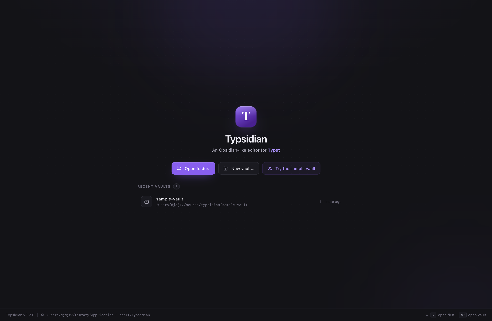

# Typsidian

A standalone macOS app — and an Obsidian-like editor for **Typst**.



Open a folder of notes, pick up where you left off from recent vaults, and work
with one document in three ways:


| Mode | What it does | Shortcut |
| --- | --- | --- |
| **Split** | Markup on the left, typeset pages on the right. Click the preview to jump to source. | `⌥1` |
| **Visual** | The page fills the window. Hover a block, click it, edit it in place. | `⌥2` |
| **Preview** | Read the typeset document. | `⌥3` |

Everything is real Typst, compiled by Typst itself, using your machine's real
fonts. A vault is just a folder of `.typ` files — open, edit and save them right
where they live, no import step, no database.

## Install & run

```bash
bun install
bun run build:native         # once: Rust typst-syntax parser (the app works without it)
bun run desktop:run          # build + launch the desktop app (Electron)
```

Build a double-clickable app bundle:

```bash
bun run desktop:package      # -> dist-app/mac-arm64/Typsidian.app
bun run desktop:dmg          # -> dist-app/Typsidian-<version>.dmg
```

The bundle is ad-hoc unsigned (no Developer ID in this environment), so it runs
locally but is not notarized for distribution. `desktop:package` is a one-command
rebuild: native parser → server bundle → web bundle → icon → `.app`.

Browser development (fast HMR, same UI):

```bash
bun run dev                  # server on 127.0.0.1:4747 + vite on localhost:5173
open http://localhost:5173
```

Requirements: macOS (arm64), [Bun](https://bun.sh) 1.2+, and a `typst` binary on
`PATH` (used only for ranged compile diagnostics; the editor works without it).
The native Typst compiler ships prebuilt for `darwin-arm64`.

### Vaults

A vault is just a folder of `.typ` files — nothing is imported or converted. On
launch Typsidian shows a welcome screen with your recent vaults:

- **Open folder…** — pick any existing folder (native macOS dialog).
- **New vault…** — create an empty vault (or `~/Documents/Typsidian` in the
  browser build) and start writing.
- **Try the sample vault** — copies the bundled demo vault to
  `~/Documents/Typsidian Sample`.

Recent vaults are stored in `~/Library/Application Support/Typsidian/` (the
desktop app) or `~/.typsidian/` (dev server). Switch vaults any time from the
vault menu at the top of the sidebar; **Close vault** returns to the welcome
screen.

## Features

- **Live typesetting** — keystrokes re-render in ~10 ms (native compiler, LRU
  cache, debounced rendering).
- **Click-to-source** — click anywhere on a rendered page; the caret lands on
  the corresponding block. The outline panel does the same.
- **Inline visual editing** — click a rendered block to get a floating editor
  with typst highlighting and block actions (heading levels, lists, code,
  equations, quotes, bold/italic/code). Edits re-typeset live; `Esc` closes.
  Code blocks and display equations edit their *contents* — the fences and `$`
  delimiters are preserved for you.


- **Real text selection** in the preview: the SVG carries invisible text runs, so
  you can select and copy prose from the typeset page.
- **Diagnostics** — compile errors and warnings, underlined in the source and
  listed in the Problems panel with line/column (sourced from the `typst` CLI for
  exact spans).
- **Standalone macOS app** — `dist-app/mac-arm64/Typsidian.app`: native window,
  menu bar, folder pickers, drag-and-drop-free vault switching.
- **Vaults** — welcome screen with recent vaults, open any folder, create a new
  vault, import the bundled sample vault, switch or close vaults from the
  sidebar menu. File tree with folders, create / rename / delete, autosave, a
  file watcher that picks up external edits via SSE, and a quick filter.
- **Export** — `⌘⇧E` downloads the compiled PDF.
- **Themes** — dark and light, both driven by design tokens.
- **Language-agnostic core** — see below. Typst is an adapter, not a dependency
  of the UI.

### Keyboard

| Shortcut | Action |
| --- | --- |
| `⌥1` / `⌥2` / `⌥3` | Split / visual / preview mode |
| `⌘O` | Open a vault |
| `⌘N` | New note (in the desktop app) |
| `⌘S` | Save (autosave also runs after 900 ms idle) |
| `⌘⇧E` | Export PDF |
| `⌘\` | Toggle sidebar |
| `Esc` | Close the inline editor / problems panel |
| `⌘/` | Toggle line comment |
| `Tab` | Indent selection |

## The universal document core

The UI never imports a Typst module. A language is a plugin with **two halves**
defined in [`shared/doc.ts`](shared/doc.ts):

```
                 ┌─────────────────────────────┐
   source ──────▶│  DocumentAdapter (server)   │──▶ RenderResult
                 │  parse · render · pdf       │    pages + boxes + diagnostics
                 └─────────────────────────────┘
                 ┌─────────────────────────────┐
   clicks ──────▶│  LanguageClient (browser)   │──▶ splices, actions, highlighting
                 │  pure string functions      │
                 └─────────────────────────────┘
```

A `RenderResult` is the only thing the surfaces consume:

```ts
interface RenderResult {
  blocks: DocBlock[];      // addressable units with exact source ranges
  pages: RenderedPage[];   // self-contained SVG per page
  boxes: BlockBox[];       // where each block landed, in page-local points
  diagnostics: RenderDiagnostic[];
  outline: OutlineItem[];
  stats: RenderStats;
}
```

That gives every feature one of a handful of language-independent primitives:

- **render a block** → `DocumentAdapter.renderBlock` (optional capability) or the
  block's `BlockBox` inside the page render;
- **jump to source when clicking the result** → `boxes` + `blockAtPoint()`;
- **edit a block visually** → `LanguageClient.editableText` + `spliceBlockEdit`
  returning a `SourceSplice` (a minimal text edit), applied by the shell;
- **show actions / highlighting** → `LanguageClient.actions` /
  `editorExtensions`;
- **outline, diagnostics** → `outline` / `diagnostics` of the render.

The three modes are therefore pure UI compositions over the same render: split
adds a source editor, visual adds a floating block editor, preview adds nothing.
Supporting Markdown means writing `server/engine/markdown/adapter.ts` (parse,
render, boxes) plus `web/src/languages/markdown.ts` (editable text, actions,
CodeMirror language). No shell component changes.

### How Typst block geometry works

Typst's layout does not retain source spans for text runs, so the adapter
manufactures the mapping with introspection:

1. Split markup into layout-safe blocks
   ([`server/engine/typst/blocks.ts`](server/engine/typst/blocks.ts)); with the
   native parser helper in [`native/`](native) when it is built, otherwise a
   conservative scanner that never splits inside code brackets or raw fences.
2. Instrument the source with one invisible marker line per block:
   `#context[#metadata((typsidian_block: N, x: here().position().x, …))]`.
   `metadata` contributes no layout, so the typeset output is byte-identical
   except for unrelated content hashes (verified by the engine tests).
3. Compile the clean source → per-page SVG; query the markers → page-local
   positions; fold positions into rectangles per block.

For exact error spans the adapter also runs the local `typst` CLI with
`--diagnostic-format short` — only when a compile reports diagnostics, cached by
source hash.

## Architecture

```
electron/          desktop shell: window, native menu, folder dialogs, packaging
build/             generated app icon (build/icon.png)
shared/            universal document model + client/server protocol (no deps)
server/            express API, vault IO, language registry
  engine/typst/    Typst DocumentAdapter (native compiler, SVG splitting, geometry)
web/src/           React app
  store.ts         app state: tabs, renders, debounced render, autosave, edit sessions
  editor/          CodeMirror 6 source pane
  preview/         page stack, hit testing, scroll sync, zoom
  visual/          floating inline block editor
  sidebar/         file tree, outline, vault watcher hook
  languages/       LanguageClient implementations (typst, plain)
native/            optional Rust helper: typst-syntax based block parser
scripts/           headless verification suites
```

Data flow: `source → store (debounce) → POST /api/render → RenderResult → all
three surfaces`. Edits that come from a surface are converted to `SourceSplice`s
locally (no server round-trip), applied to the single source of truth in the
store, and re-rendered.

Visual-mode edits are tracked in an *edit session* that keeps the edited block's
range in sync with the live source, so a fast keystroke never splices against a
stale render.

## Development

```bash
bun run dev            # server + vite (browser mode)
bun run typecheck      # tsc --noEmit
bun run build:web      # production bundle → dist/
bun run build:server   # server bundle for Electron → dist-server/
bun run build:native   # optional Rust parser helper → native/target/release/
bun run start          # production server: serves dist/ + the API

bun scripts/test-engine.mts      # engine invariants (blocks, layout neutrality)
bun scripts/test-vaults.mts      # vault open/create/close, recents, watcher swap
bun scripts/verify-ui.mjs        # headless Chrome interaction suite
bun scripts/verify-errors.mjs    # diagnostics, heading edits, paging
bun scripts/verify-vaults.mjs    # welcome screen, recents, native-bridge simulation
bun scripts/verify-app.mjs       # drives the packaged .app over CDP
```

Runtime and package manager: **Bun**. Electron runs the UI with the same server
as a child process (`ELECTRON_RUN_AS_NODE`), so there is exactly one
implementation of the engine.

The verification scripts drive real Chrome via `puppeteer-core` and leave
screenshots in `/tmp/typsidian-shots`.


## Architecture (desktop)

```
Typsidian.app
  └─ Electron main  ──spawns──▶  dist-server/index.cjs  (bun/Node, forked)
       │                              │
       │  IPC: folder pickers         │  express API + typst native compiler
       ▼                              ▼
     renderer  ───── HTTP ─────▶  http://127.0.0.1:<free port>  (serves dist/)
```

The renderer is ordinary web code: in the browser it degrades to a typed path
for "open folder", in Electron the preload bridge (`window.typsidian`) offers
native dialogs. Menu commands call into the app through a small renderer API
(`window.__typsidianMenu`) instead of IPC data channels, so there is one code
path for both environments.

## Known limitations

- Typst only. Markdown is a stub (`web/src/languages/plain.ts`); the adapter
  interface is designed for it but not implemented yet.
- Block hit boxes are block-level, not glyph-level: a click maps to the block
  (heading, paragraph, list, code, equation, table) that owns the point.
- Warnings without a CLI are reported without ranges; the `typst` CLI is used
  for exact spans.
- No multiplayer, no sync, no search-replace across the vault yet (file search
  exists, `/api/search`).
