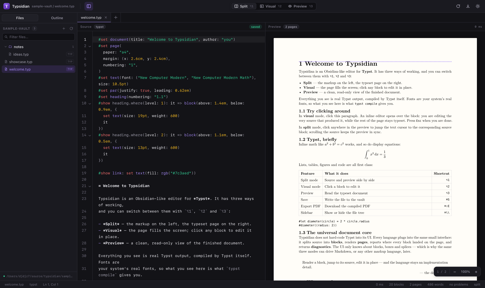
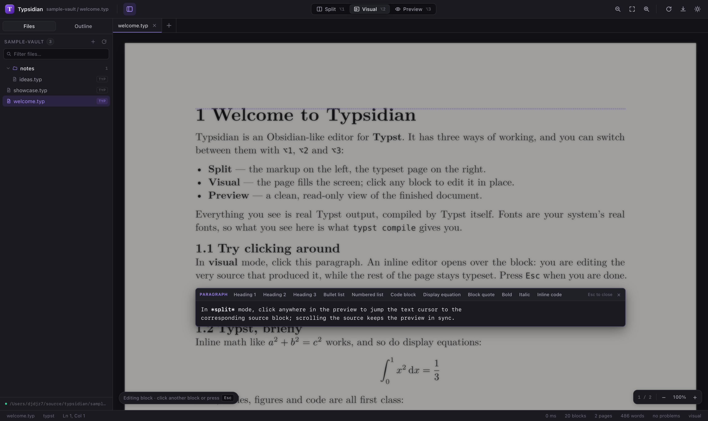
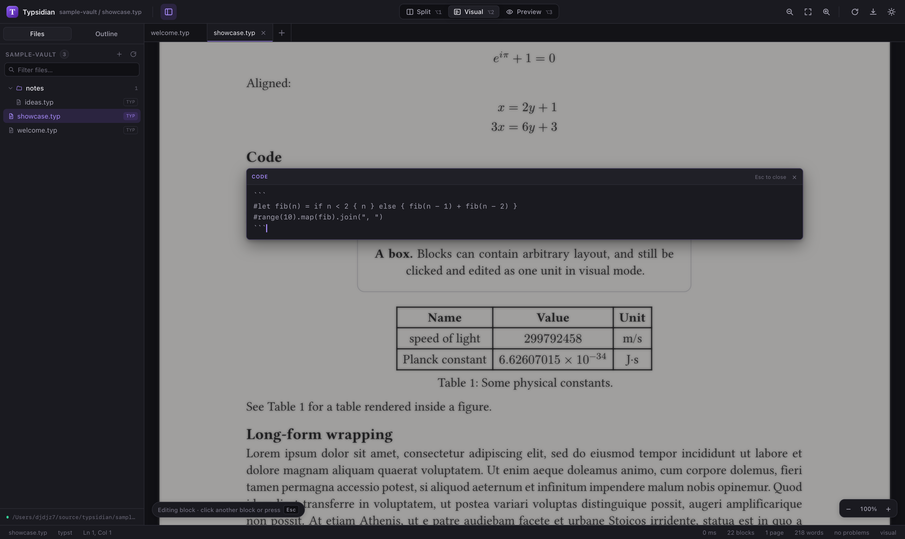
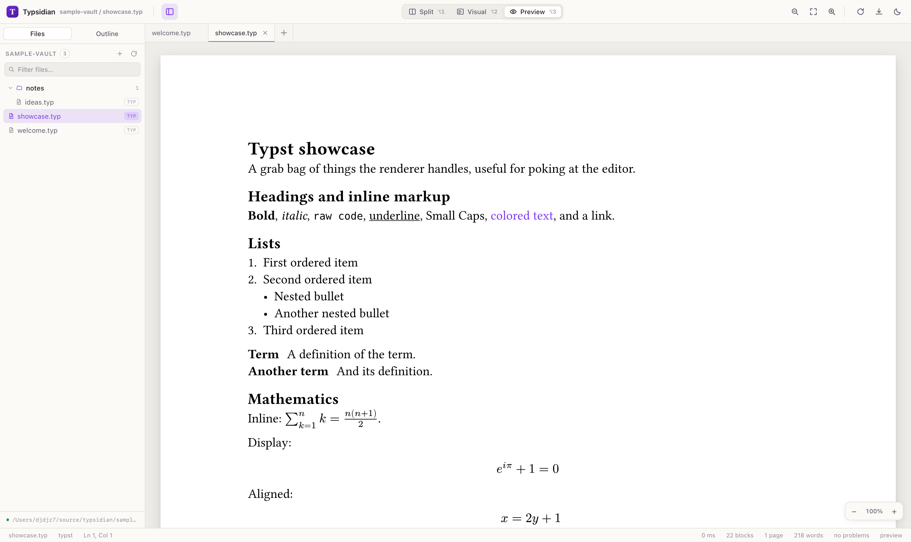

# Typsidian

An Obsidian-like editor for **Typst**. Three ways to work with one document:





| Mode | What it does | Shortcut |
| --- | --- | --- |
| **Split** | Markup on the left, typeset pages on the right. Click the preview to jump to source. | `⌥1` |
| **Visual** | The page fills the window. Hover a block, click it, edit it in place. | `⌥2` |
| **Preview** | Read the typeset document. | `⌥3` |

Everything is real Typst, compiled by Typst itself, using your machine's real
fonts. A vault is just a folder of `.typ` files.

## Quick start

```bash
npm install
npm run build:native   # optional but recommended: parser helper ("npm run dev" works without it)
npm run dev            # server (127.0.0.1:4747) + web (localhost:5173)
open http://localhost:5173
```

The default vault is [`sample-vault/`](sample-vault) (edit it freely — it is in
the repo). Point it at another folder:

```bash
TYPSIDIAN_VAULT="$HOME/Documents/notes" npm run dev
```

Requirements: macOS, Node 22+, and a `typst` binary on `PATH` (used only for
ranged compile diagnostics; the editor works without it). Native dependencies
are prebuilt for `darwin-arm64` by `@myriaddreamin/typst-ts-node-compiler`.

## Features

- **Live typesetting** — keystrokes re-render in ~10 ms (native compiler, LRU
  cache, debounced rendering).
- **Click-to-source** — click anywhere on a rendered page; the caret lands on
  the corresponding block. The outline panel does the same.
- **Inline visual editing** — click a rendered block to get a floating editor
  with typst highlighting and block actions (heading levels, lists, code,
  equations, quotes, bold/italic/code). Edits re-typeset live; `Esc` closes.
  Code blocks and display equations edit their *contents* — the fences and `$`
  delimiters are preserved for you.


- **Real text selection** in the preview: the SVG carries invisible text runs, so
  you can select and copy prose from the typeset page.
- **Diagnostics** — compile errors and warnings, underlined in the source and
  listed in the Problems panel with line/column (sourced from the `typst` CLI for
  exact spans).
- **Vault** — file tree with folders, create / rename / delete, autosave, a file
  watcher that picks up external edits via SSE, and a quick filter.
- **Export** — `⌘⇧E` downloads the compiled PDF.
- **Themes** — dark and light, both driven by design tokens.
- **Language-agnostic core** — see below. Typst is an adapter, not a dependency
  of the UI.

### Keyboard

| Shortcut | Action |
| --- | --- |
| `⌥1` / `⌥2` / `⌥3` | Split / visual / preview mode |
| `⌘S` | Save (autosave also runs after 900 ms idle) |
| `⌘⇧E` | Export PDF |
| `⌘\` | Toggle sidebar |
| `Esc` | Close the inline editor / problems panel |
| `⌘/` | Toggle line comment |
| `Tab` | Indent selection |

## The universal document core

The UI never imports a Typst module. A language is a plugin with **two halves**
defined in [`shared/doc.ts`](shared/doc.ts):

```
                 ┌─────────────────────────────┐
   source ──────▶│  DocumentAdapter (server)   │──▶ RenderResult
                 │  parse · render · pdf       │    pages + boxes + diagnostics
                 └─────────────────────────────┘
                 ┌─────────────────────────────┐
   clicks ──────▶│  LanguageClient (browser)   │──▶ splices, actions, highlighting
                 │  pure string functions      │
                 └─────────────────────────────┘
```

A `RenderResult` is the only thing the surfaces consume:

```ts
interface RenderResult {
  blocks: DocBlock[];      // addressable units with exact source ranges
  pages: RenderedPage[];   // self-contained SVG per page
  boxes: BlockBox[];       // where each block landed, in page-local points
  diagnostics: RenderDiagnostic[];
  outline: OutlineItem[];
  stats: RenderStats;
}
```

That gives every feature one of a handful of language-independent primitives:

- **render a block** → `DocumentAdapter.renderBlock` (optional capability) or the
  block's `BlockBox` inside the page render;
- **jump to source when clicking the result** → `boxes` + `blockAtPoint()`;
- **edit a block visually** → `LanguageClient.editableText` + `spliceBlockEdit`
  returning a `SourceSplice` (a minimal text edit), applied by the shell;
- **show actions / highlighting** → `LanguageClient.actions` /
  `editorExtensions`;
- **outline, diagnostics** → `outline` / `diagnostics` of the render.

The three modes are therefore pure UI compositions over the same render: split
adds a source editor, visual adds a floating block editor, preview adds nothing.
Supporting Markdown means writing `server/engine/markdown/adapter.ts` (parse,
render, boxes) plus `web/src/languages/markdown.ts` (editable text, actions,
CodeMirror language). No shell component changes.

### How Typst block geometry works

Typst's layout does not retain source spans for text runs, so the adapter
manufactures the mapping with introspection:

1. Split markup into layout-safe blocks
   ([`server/engine/typst/blocks.ts`](server/engine/typst/blocks.ts)); with the
   native parser helper in [`native/`](native) when it is built, otherwise a
   conservative scanner that never splits inside code brackets or raw fences.
2. Instrument the source with one invisible marker line per block:
   `#context[#metadata((typsidian_block: N, x: here().position().x, …))]`.
   `metadata` contributes no layout, so the typeset output is byte-identical
   except for unrelated content hashes (verified by the engine tests).
3. Compile the clean source → per-page SVG; query the markers → page-local
   positions; fold positions into rectangles per block.

For exact error spans the adapter also runs the local `typst` CLI with
`--diagnostic-format short` — only when a compile reports diagnostics, cached by
source hash.

## Architecture

```
shared/            universal document model + client/server protocol (no deps)
server/            express API, vault IO, language registry
  engine/typst/    Typst DocumentAdapter (native compiler, SVG splitting, geometry)
web/src/           React app
  store.ts         app state: tabs, renders, debounced render, autosave, edit sessions
  editor/          CodeMirror 6 source pane
  preview/         page stack, hit testing, scroll sync, zoom
  visual/          floating inline block editor
  sidebar/         file tree, outline, vault watcher hook
  languages/       LanguageClient implementations (typst, plain)
native/            optional Rust helper: typst-syntax based block parser
scripts/           headless verification suites
```

Data flow: `source → store (debounce) → POST /api/render → RenderResult → all
three surfaces`. Edits that come from a surface are converted to `SourceSplice`s
locally (no server round-trip), applied to the single source of truth in the
store, and re-rendered.

Visual-mode edits are tracked in an *edit session* that keeps the edited block's
range in sync with the live source, so a fast keystroke never splices against a
stale render.

## Development

```bash
npm run dev            # server + vite
npm run typecheck      # tsc --noEmit
npm run build:web      # production bundle → dist/
npm run build:native   # optional Rust parser helper → native/target/release/
npm start              # production: serves dist/ from the API server
node scripts/verify-ui.mjs       # headless Chrome interaction suite (24 checks)
node scripts/verify-errors.mjs   # diagnostics, heading edits, paging
npx tsx scripts/test-engine.mts  # engine invariants (blocks, layout neutrality)
```

The verification scripts drive real Chrome via `puppeteer-core` and leave
screenshots in `/tmp/typsidian-shots`.



## Known limitations

- Typst only. Markdown is a stub (`web/src/languages/plain.ts`); the adapter
  interface is designed for it but not implemented yet.
- Block hit boxes are block-level, not glyph-level: a click maps to the block
  (heading, paragraph, list, code, equation, table) that owns the point.
- Warnings without a CLI are reported without ranges; the `typst` CLI is used
  for exact spans.
- No multiplayer, no sync, no search-replace across the vault yet (file search
  exists, `/api/search`).
